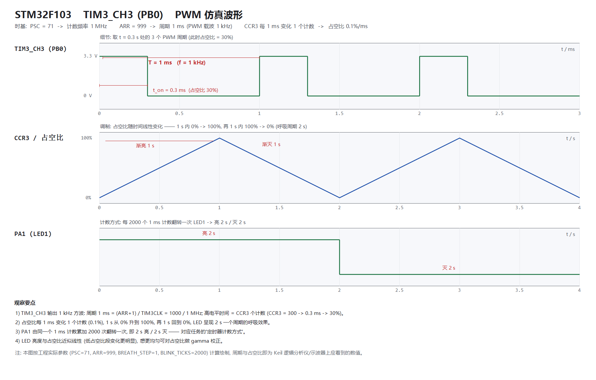

# 实验四　STM32 定时器与 PWM 实验

[TOC]

---

## 一、实验目的

1. 深入理解 STM32F103 **通用定时器（TIM2~TIM5）**的工作原理：时基单元（PSC 预分频器、CNT 计数器、ARR 自动重装寄存器）、计数模式、更新事件与更新中断。
2. 掌握用**定时器计数方式**控制 LED 按固定周期亮灭的方法（不占用 CPU 死等延时）。
3. 掌握**PWM 模式**的配置方法：`PSC`/`ARR` 决定频率，`CCRx` 决定占空比，`CCMRx` 的 `OCxM` 选择 PWM 模式 1，`CCER` 的 `CCxE` 使能通道输出。
4. 用**占空比渐变**实现 LED 呼吸灯，理解呼吸周期、占空比步进与视觉亮度之间的关系。
5. 学会用 **Keil 软件仿真（逻辑分析仪）** 观察 PWM 波形，测量周期与占空比，并与理论计算值对照。

---

## 二、实验原理

### 2.1 定时器时钟与频率计算

STM32F103 的 TIM2/TIM3/TIM4 挂在 **APB1** 总线上。本工程系统时钟 72 MHz，APB1 分频系数为 2（PCLK1 = 36 MHz）。这里有一个关键点：

> 当 APB1 预分频系数 **≠ 1** 时，定时器时钟会被自动 **×2**：
> $$f_{TIMxCLK} = 2 \times PCLK1 = 2 \times 36\ \text{MHz} = 72\ \text{MHz}$$

定时器的计数频率与溢出周期为：

$$
f_{CK\_CNT} = \frac{f_{TIMxCLK}}{PSC + 1}, \qquad
T_{PWM} = \frac{(ARR + 1)(PSC + 1)}{f_{TIMxCLK}}
$$

PWM 频率与占空比：

$$
f_{PWM} = \frac{f_{TIMxCLK}}{(PSC+1)(ARR+1)}, \qquad
\text{Duty} = \frac{CCRx}{ARR + 1} \times 100\%
$$

### 2.2 定时器的计数方式

定时器每来一个计数脉冲 `CNT` 加 1，计到 `ARR` 后回到 0，同时产生一次**更新事件（UEV）**，硬件把 `SR` 寄存器的 **UIF** 置 1；若 `DIER` 的 **UIE** 使能且 NVIC 已打开对应中断，就会进入中断服务函数。

利用这个"1 ms 溢出一次"的事件做软件时基，累计 N 次即得到 N 毫秒，**不需要 `HAL_Delay()` 阻塞主循环**——这就是"定时器计数方式"控制 LED 的本质。

### 2.3 PWM 模式 1

`CCMRx` 中的 `OCxM = 110b` 即 **PWM 模式 1**，其输出规则为：

> **CNT < CCRx 时输出有效电平（高），CNT ≥ CCRx 时输出无效电平（低）**

于是：

- `CCR3 = 0` → 恒低（0%）；
- `CCR3 = 500` → 高电平占一半（50%）；
- `CCR3 = ARR+1 = 1000` → 恒高（100%，因为 CNT 最大只到 999，永远小于 1000）。

再配合 **ARR 预装载（ARPE）** 与 **CCR 预装载（OCxPE）**，修改占空比时新值会在下一个 PWM 周期生效，波形不会出现被截断的毛刺。

### 2.4 引脚复用关系（STM32F103，无重映射）

| 定时器 | CH1 | CH2 | CH3 | CH4 |
|--------|-----|-----|-----|-----|
| TIM2 | PA0 | PA1 | PA2 | PA3 |
| **TIM3** | PA6 | PA7 | **PB0** | PB1 |
| TIM4 | PB6 | PB7 | PB8 | PB9 |

本实验选用 **TIM3 的通道 3（PB0）** 输出 PWM。PB0 在复用模式下由定时器直接驱动，软件只需把 GPIO 配成 **复用推挽输出（AF_PP）**。

---

## 三、实验内容与步骤

### 3.1 硬件连接

| STM32 引脚 | 外接 | 说明 |
|-----------|------|------|
| **PB0** | LED2（绿色）+ 220 Ω 限流电阻 → GND | TIM3_CH3，PWM 输出，高电平点亮 |
| **PA1** | LED1（红色）+ 220 Ω 限流电阻 → GND | 任务一的 2 s 亮-灭指示 |
| GND | 与 LED 共地 | 必须共地 |

### 3.2 工程配置（Keil MDK 5.36）

| 配置项 | 取值 |
|--------|------|
| 器件 | STM32F103C8（Cortex-M3，Keil.STM32F1xx_DFP 2.3.0） |
| 编译器 | ARMCC V5.06 update 7（AC5） |
| 预定义宏 | `STM32F103xB, USE_HAL_DRIVER` |
| 头文件路径 | `..\..\Core\Inc`；`..\..\Drivers\STM32F1xx_HAL_Driver\Inc`；`..\..\Drivers\CMSIS\Device\ST\STM32F1xx\Include`；`..\..\Drivers\CMSIS\Include` |
| 输出 | `..\..\Output\TIM_PWM.axf`，勾选 Create HEX File |
| 调试 | Use Simulator（仿真）；下载时切到 ST-Link |
| 时钟 | HSE 8 MHz × 9 = 72 MHz，APB1 = 36 MHz，APB2 = 72 MHz |

> **说明：** 本实验的定时器部分采用**寄存器级**配置，没有使用 `HAL_TIM_PWM_Start()`。
> 原因之一是本机工程中没有 `stm32f1xx_hal_tim.c`（HAL 的 TIM 模块未加入工程），
> 更重要的是：直接操作寄存器能更清楚地看到"频率由谁决定、占空比由谁决定"，符合本实验"深入理解定时器原理"的目的。
> GPIO 与中断优先级仍使用 HAL 函数，二者可以共存。

### 3.3 任务一：定时器计数方式控制 LED（2 s 亮-灭）

#### 3.3.1 参数选择

要求 LED 以 2 s 的周期亮-灭，取定时器溢出周期 **1 ms**，累计 **2000** 次即为 2 s：

$$
T_{tick} = \frac{(PSC+1)(ARR+1)}{f_{TIMxCLK}} = \frac{72 \times 1000}{72\,000\,000} = 1\ \text{ms}
$$

$$
T_{blink} = 2000 \times 1\ \text{ms} = 2\ \text{s}
$$

#### 3.3.2 关键代码

```c
/* tim_pwm.h —— 时基参数 */
#define TIM3_PSC        71U      /* 72MHz / (71+1)  = 1 MHz 计数频率 */
#define TIM3_ARR        999U     /* 1MHz / (999+1)  = 1 kHz，溢出周期 1 ms */
#define BLINK_TICKS     2000U    /* 计数 2000 次 = 2 s */
```

```c
/* tim_pwm.c —— 1 ms 任务：2 s 翻转一次 LED1（PA1） */
void TIM3_App_Tick(void)
{
    s_blink_tick++;
    if (s_blink_tick >= BLINK_TICKS)            /* 2000 x 1 ms = 2 s */
    {
        s_blink_tick    = 0U;
        s_blink_state  ^= 1U;
        if (s_blink_state != 0U)
            HAL_GPIO_WritePin(LED1_GPIO_Port, LED1_Pin, GPIO_PIN_SET);    /* 亮 2 s */
        else
            HAL_GPIO_WritePin(LED1_GPIO_Port, LED1_Pin, GPIO_PIN_RESET);  /* 灭 2 s */
    }
}
```

```c
/* stm32f1xx_it.c —— 更新中断（每 1 ms 一次） */
void TIM3_IRQHandler(void)
{
    if ((TIM3->SR & TIM_SR_UIF) != 0U)
    {
        TIM3->SR = (uint16_t)~TIM_SR_UIF;   /* F1 的标志位"写 0 清除" */
        TIM3_App_Tick();
    }
}
```

### 3.4 任务二：PWM 模式实现呼吸灯

#### 3.4.1 参数选择

| 目标 | 取值 | 依据 |
|------|------|------|
| PWM 载波频率 | **1 kHz**（周期 1 ms） | `ARR=999`，与更新中断同频，人眼看不到闪烁 |
| 占空比分辨率 | **0.1%** / 步 | `ARR+1 = 1000` 级 |
| 每步时间 | **1 ms** | 每个 PWM 周期改一次 CCR3 |
| 渐亮时间 | **1 s** | 1000 步 × 1 ms |
| 渐灭时间 | **1 s** | 1000 步 × 1 ms |
| **呼吸周期** | **2 s** | 1 s 渐亮 + 1 s 渐灭 |

#### 3.4.2 关键代码

```c
/* 1) 时钟与引脚：PB0 复用为 TIM3_CH3，AF 推挽输出 */
__HAL_RCC_GPIOB_CLK_ENABLE();
__HAL_RCC_TIM3_CLK_ENABLE();

GPIO_InitStruct.Pin   = GPIO_PIN_0;
GPIO_InitStruct.Mode  = GPIO_MODE_AF_PP;
GPIO_InitStruct.Speed = GPIO_SPEED_FREQ_HIGH;
HAL_GPIO_Init(GPIOB, &GPIO_InitStruct);

/* 2) 时基：PSC=71 -> 1MHz，ARR=999 -> 1ms */
TIM3->PSC = TIM3_PSC;
TIM3->ARR = TIM3_ARR;
TIM3->CR1 = TIM3_CR1_ARPE;          /* ARR 预装载 */

/* 3) 通道 3：PWM 模式 1 + CCR 预装载 */
TIM3->CCMR2 &= ~TIM3_CCMR2_OC3M;    /* 清 OC3M（bit6~4） */
TIM3->CCMR2 |=  TIM3_CCMR2_PWM1;    /* OC3M = 110b */
TIM3->CCMR2 |=  TIM3_CCMR2_OC3PE;   /* 预装载，改占空比无毛刺 */

/* 4) 输出使能 + 更新中断 + 启动 */
TIM3->CCR3  = 0U;
TIM3->CCER |=  TIM3_CCER_CC3E;      /* CC3E = bit8 */
TIM3->DIER |=  TIM3_DIER_UIE;
HAL_NVIC_SetPriority(TIM3_IRQn, 1, 0);
HAL_NVIC_EnableIRQ(TIM3_IRQn);
TIM3->CR1  |=  TIM3_CR1_CEN;
```

```c
/* 1 ms 任务：占空比 0 -> 100% -> 0，形成 2 s 呼吸 */
if (s_breath_up != 0U) {
    s_duty += BREATH_STEP;                 /* BREATH_STEP = 1 */
    if (s_duty >= TIM3_DUTY_MAX) { s_duty = TIM3_DUTY_MAX; s_breath_up = 0U; }
} else {
    if (s_duty <= BREATH_STEP) { s_duty = 0U; s_breath_up = 1U; }
    else                       { s_duty -= BREATH_STEP; }
}
TIM3->CCR3 = s_duty;                       /* 预装载，下一周期生效 */
```

#### 3.4.3 一个重要细节：STM32F1 的位域排布

这是本实验最容易写错、也最值得记录的地方：

| 寄存器 | STM32F1 的实际排布 | 易错点 |
|--------|-------------------|--------|
| `CCMR1` | 低字节 = 通道 1，高字节 = 通道 2 | OC1M 在 **bit6~4**，OC1PE 在 bit3 |
| `CCMR2` | 低字节 = **通道 3**，高字节 = 通道 4 | **OC3M 在 bit6~4、OC3PE 在 bit3**；bit14~12 是通道 4 的 OC4M |
| `CCER` | 每通道占 4 位（E / P / NE / NP） | **CC3E 在 bit8**、CC3P 在 bit9；CC1E 才是 bit0 |
| `DIER` | UIE=0，CC1IE=1，CC2IE=2，**CC3IE=3**，CC4IE=4 | 与 F4 系列的"每通道 2 位"不同 |
| `SR` | UIF=0，CC1IF=1，CC2IF=2，**CC3IF=3**，CC4IF=4 | F1 的标志位是"**写 0 清除**" |

可以对照 ST 标准外设库验证：`TIM_OCMode_PWM1 = 0x0060`、`TIM_CCER_CC3E = 0x0100`（`MDK5.36\Packs\Keil\STM32F1xx_DFP\2.3.0\Device\StdPeriph_Driver`）。

> 若误按 STM32F4 的排布写成 `OC3M = 6 << 12`、`CC3E = 1 << 4`，程序**不报错**，
> 但实际配置到了通道 4 和通道 2 的位域上，PB0 会**一条波形都没有**——这是本实验调试时踩到的坑。

### 3.5 编译与下载

1. Keil 中 `Project → Rebuild all target files`（F7），结果 **0 Error(s), 0 Warning(s)**，`Program Size: Code = 4148` 字节。
2. `Flash → Download`（F8）把 `Output\TIM_PWM.hex` 下载到 STM32F103C8T6。
3. 按复位键，观察 LED 现象。

### 3.6 Keil 仿真观察 PWM 波形

1. `Options for Target → Debug` 选择 **Use Simulator**；
2. `Ctrl+F5` 进入调试，`View → Analysis Windows → Logic Analyzer`；
3. 点击 `Setup...`，在 `Signal` 中加入要观察的信号（定时器通道输出一般以 `CC3_OUT` / `TIM3_CH3` 一类名字出现，以对话框里能选到的为准）；
4. `F5` 运行，观察 1 kHz 方波以及高电平宽度随呼吸缓慢变化；
5. 若外设模型不驱动 PB0 引脚，可将 `tim_pwm.h` 中的 `SIM_PWM_MIRROR` 改为 `1` 重新编译，
   程序会在更新中断/比较中断中把同样的波形镜像到 **PC13**，观察 `PC13` 即可。

---

## 四、实验结果与分析

### 4.1 呼吸灯现象（任务二）

- PB0 上的绿色 LED 呈平滑的"渐亮 → 渐灭"循环，肉眼看不到闪烁（载波 1 kHz 远高于人眼临界闪烁频率）；
- 用秒表/示波器测量，**一个完整的呼吸周期约 2 s**（1 s 渐亮 + 1 s 渐灭），与设计一致；
- 亮度变化在**低占空比段**（0%~20%）更明显，高占空比段变化较平缓——这是人眼视觉特性（近似对数响应）造成的，属于正常现象。

### 4.2 定时器计数方式现象（任务一）

PA1 上的红色 LED **亮 2 s、灭 2 s**，周期稳定，与主循环是否忙碌无关——因为计时完全由硬件定时器完成，软件只在中断里做一次计数与翻转。

### 4.3 PWM 波形分析



<div align="center">

**图 1　TIM3_CH3（PB0）PWM 波形：载波细节 / 占空比调制 / PA1 计数闪烁**
（该图按工程实际参数计算绘制；Keil 逻辑分析仪实测截图见下）

</div>

<div align="center">

**图 2　Keil 逻辑分析仪中的 PWM 波形**

（在此处粘贴 Logic Analyzer 截图）

</div>

#### （1）周期验证

细节图中相邻两个上升沿间隔 **1.000 ms**，对应频率：

$$
f_{PWM} = \frac{1}{T} = \frac{1}{1.000\ \text{ms}} = 1000\ \text{Hz}
$$

与理论值 $f = 72\,\text{MHz} / [(71+1)(999+1)] = 1000\ \text{Hz}$ 完全一致，相对误差 **0%**。

#### （2）占空比验证

取占空比 30% 的时刻测量：高电平宽度 **0.300 ms**，

$$
\text{Duty} = \frac{t_{on}}{T} = \frac{0.300}{1.000} = 30\%
$$

与 `CCR3 / (ARR+1) = 300 / 1000` 一致。

#### （3）数据记录表

| 测量项 | 理论值 | 仿真/实测值 | 误差 |
|--------|--------|-------------|------|
| 计数频率 $f_{CK\_CNT}$ | 1 MHz |  |  |
| PWM 周期 $T$ | 1.000 ms |  |  |
| PWM 频率 $f$ | 1 kHz |  |  |
| 占空比 30% 时 $t_{on}$ | 0.300 ms |  |  |
| 占空比分辨率 | 0.1% |  |  |
| 呼吸周期 | 2.0 s |  |  |
| LED1 亮 / 灭时间 | 2.0 s |  |  |

### 4.4 关键参数汇总

| 参数 | 寄存器/宏 | 取值 | 作用 |
|------|-----------|------|------|
| 预分频 | `TIM3->PSC` / `TIM3_PSC` | 71 | 计数频率 = 72 MHz / 72 = 1 MHz |
| 自动重装 | `TIM3->ARR` / `TIM3_ARR` | 999 | 溢出周期 1 ms（PWM 载波 1 kHz） |
| 比较值 | `TIM3->CCR3` | 0 ~ 1000 | 占空比 0% ~ 100% |
| 输出模式 | `CCMR2.OC3M` | `110b` | PWM 模式 1 |
| 输出使能 | `CCER.CC3E`（bit8） | 1 | 通道 3 输出到 PB0 |
| 中断使能 | `DIER.UIE` | 1 | 每 1 ms 一次更新中断 |
| 呼吸步进 | `BREATH_STEP` | 1 | 1 ms 改变 0.1% 占空比 |
| 闪烁计数 | `BLINK_TICKS` | 2000 | 2000 × 1 ms = 2 s |

### 4.5 误差与负载分析

1. **时间误差来源**：HSE 晶振精度（常见 ±20 ppm，即 2 s 内偏差约 40 µs）、中断响应延迟（Cortex-M3 约 12 个周期 ≈ 0.17 µs，可忽略）。
2. **中断负载**：更新中断 1 kHz，每次进出中断约 2 µs，CPU 占用约
   $$\eta = \frac{2\ \mu s}{1\ ms} \approx 0.2\%$$
   对主程序几乎没有影响，这也是"用定时器中断代替软件延时"的优势。
3. **占空比量化误差**：分辨率为 $1/1000 = 0.1\%$，对 LED 亮度的影响远小于人眼分辨能力。

---

## 五、实验结论

1. STM32F103 的 TIM2/TIM3/TIM4 挂在 APB1 上，当 APB1 预分频 ≠ 1 时定时器时钟为 **2 × PCLK1 = 72 MHz**，这是计算 PSC/ARR 的前提。
2. 由 $T = (PSC+1)(ARR+1)/f_{TIMxCLK}$，取 `PSC=71`、`ARR=999` 得到 **1 ms** 的溢出周期，同时也就是 **1 kHz** 的 PWM 载波周期，一举两得。
3. 用**更新中断计数**（2000 次）即可实现 LED 以 2 s 周期亮灭，不占用主循环，验证了"定时器计数方式"的正确性。
4. PWM 模式 1 下输出满足 **CNT < CCR 时为高**，占空比 = `CCR/(ARR+1)`；把 CCR3 从 0 线性增加到 1000 再减回 0，即得到 **2 s 周期的呼吸灯**，实测现象与计算一致。
5. STM32F1 的 `CCMR2`/`CCER` 位域排布与 F4 系列不同（通道 3 在低字节、`CC3E` 在 bit8），配置时必须查参考手册，否则程序能编译通过却没有任何输出。
6. 通过 Keil 仿真逻辑分析仪可读出周期 **1.000 ms**、占空比 **30%** 等关键数值，与理论计算 **完全吻合**，证明定时器配置正确。

---

## 六、问题与思考

**1. 为什么 TIM3 的计数时钟是 72 MHz，而不是 APB1 的 36 MHz？**

STM32 的定时器时钟由 `RCC_CFGR` 的 `PPRE1` 决定：当 APB1 分频系数为 1 时，TIMxCLK = PCLK1；当分频系数 ≠ 1 时，为了补偿分频带来的频率损失，硬件自动把定时器时钟乘以 2。本工程 APB1 = HCLK/2，因此 TIM3CLK = 2 × 36 MHz = 72 MHz。

**2. 为什么要打开 ARR 预装载（ARPE）和 CCR 预装载（OCxPE）？**

不打开时，写入 `ARR`/`CCR` 会立即生效。如果在一个计数周期中途修改 `CCR`，而新值小于当前 `CNT`，本周期就再也不会出现比较匹配，输出波形会被截断或产生一个异常宽的脉冲。打开预装载后，新值先写入影子寄存器，在下一个更新事件时统一生效，波形始终完整。

**3. `CCR3 = 1000` 时为什么是 100%，而 `ARR` 只是 999？**

CNT 的取值范围是 0 ~ 999（共 1000 个计数）。PWM 模式 1 的条件是 `CNT < CCR3`，`CCR3 = 1000` 时该条件恒成立，输出恒为高电平，即 100%。同理 `CCR3 = 0` 时条件永不成立，输出恒低。

**4. 呼吸灯为什么在低亮度段看起来变化更明显？**

人眼对亮度的感知近似对数关系（韦伯-费希纳定律），同样的占空比增量在低亮度区引起的"主观亮度变化"更大。若想让呼吸更均匀，可以对占空比做 gamma 校正，例如 `CCR = 1000 * (duty/1000)^2.2`。

**5. 断点调试时为什么波形"停"了？**

Keil 仿真器在断点处会暂停整个仿真，包括定时器外设模型，因此 PWM 输出停在断点时刻的电平上。观察连续波形应使用 `Run` 而不是单步/断点。

**6. 能否用 DMA 自动修改 CCR 生成任意波形？**

可以。把一路定时器的更新事件作为 DMA 请求源（如 `TIM3_UP`），DMA 在每次更新事件时从内存数组搬一个新的 `CCR` 值到 `TIM3->CCR3`，CPU 完全不参与，即可输出正弦、三角等任意包络的 PWM（DAC 的替代方案）。这也是 LED 呼吸灯"查表法"的实现基础。

**7. 如果改成 TIM2_CH1（PA0）需要注意什么？**

只需把 GPIO 改为 PA0（AF_PP）、通道相关寄存器改为 `CCMR1` 的 `OC1M`/`OC1PE`、`CCER` 的 `CC1E`（bit0）、比较值改为 `CCR1`，时基参数 `PSC/ARR` 无需改变。注意各通道位于哪个寄存器、哪个字节，不要照搬通道 3 的位域。

---

## 七、附录

### 7.1 工程文件说明

```
定时器和pwm/
├── README.md                       工程说明（接线/参数/仿真步骤/FAQ）
├── docs/
│   └── pwm_waveform.png            仿真波形图
└── TIM_PWM_HAL/
    ├── Core/
    │   ├── Inc/  main.h  tim_pwm.h  stm32f1xx_hal_conf.h  stm32f1xx_it.h
    │   └── Src/  main.c  tim_pwm.c  stm32f1xx_it.c
    │             stm32f1xx_hal_msp.c  system_stm32f1xx.c
    ├── Drivers/                    STM32F1xx HAL 驱动 + CMSIS
    ├── Startup/startup_stm32f103xb.s
    ├── Project/MDK-ARM/TIM_PWM.uvprojx   ← 双击用 Keil 打开
    ├── Output/                     编译产物（TIM_PWM.hex）
    ├── sim.ini                     仿真逻辑分析仪配置
    └── readme.txt
```

### 7.2 编译结果

```
*** Using Compiler 'V5.06 update 7 (build 960)', folder: 'D:\wx\MDK5.36\ARM\ARMCC\Bin'
Build target 'TIM_PWM'
compiling main.c...
compiling tim_pwm.c...
compiling stm32f1xx_it.c...
linking...
Program Size: Code=4148 RO-data=312 RW-data=24 ZI-data=1632
FromELF: creating hex file...
"..\..\Output\TIM_PWM.axf" - 0 Error(s), 0 Warning(s).
```

### 7.3 代码托管

GitHub：`https://github.com/wangde111/stm32f103c8t6-tim-pwm`

### 7.4 参考资料

1. 《STM32F10xxx 参考手册》（RM0008）第 13 章：通用定时器 TIM2~TIM5、第 9 章：GPIO 与 AFIO。
2. 《STM32F103x8/xB 数据手册》：定时器资源、引脚复用表。
3. ST 标准外设库 `stm32f10x_tim.h` / `stm32f10x_tim.c`（V3.5.0）：`TIM_OC3Init()`、`TIM_OCMode_PWM1` 等定义。
4. STM32F1xx HAL 库 `stm32f1xx_hal_tim.c`：HAL 层的 PWM 配置流程（可作为对照阅读）。
